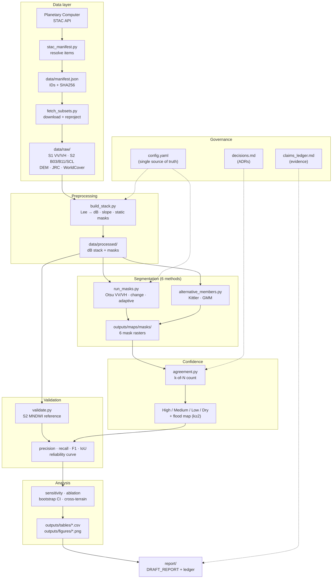
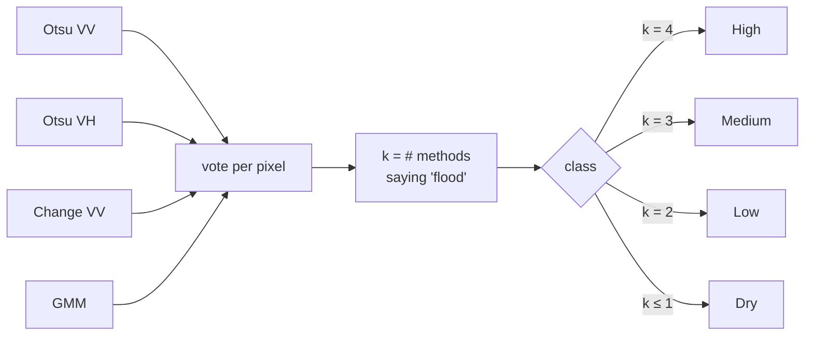

# Architecture — Brahmaputra Flood Confidence Mapping

A complete reference for how this project is structured, from data acquisition to
the validated confidence map. Diagrams are Mermaid (rendered natively by GitHub);
an ASCII fallback is included.

---

## 1. Overview

The project maps the **Brahmaputra riverine flood of 23 June 2023** from Sentinel-1
SAR using **six independent classical segmentation methods**, combines them into a
**per-pixel agreement-based confidence map**, and **validates** whether that
confidence predicts accuracy against Sentinel-2 (MNDWI).

**Core question:** *Does "how many methods agree" reliably predict how correct the
map is?*  (Answer: only when the ensemble members genuinely measure the same signal.)

---

## 2. System architecture



**ASCII fallback:**

```
Planetary Computer STAC
   │  stac_manifest.py
   ▼
manifest.json ── fetch_subsets.py ──▶ data/raw
                                        │  build_stack.py (Lee→dB, slope, masks)
                                        ▼
                                   data/processed
                          ┌─────────────┴─────────────┐
                          ▼                           ▼
                   run_masks.py              alternative_members.py
                 (Otsu VV/VH,              (Kittler, GMM)
                  change, adaptive)              │
                          │                      │
                          └──────────┬───────────┘
                                     ▼
                          agreement.py (k-of-N)
                                     ▼
                          High / Medium / Low / Dry
                                     │
                          validate.py (S2 MNDWI) ──▶ metrics + reliability curve
                                     │
                          analysis (sensitivity, ablation, bootstrap, cross-terrain)
                                     ▼
                          outputs/ (tables + figures) ──▶ report/
```

---

## 3. Data layer

| Parameter | Value |
|---|---|
| AOI (WGS84) | `[91.55, 26.00, 91.95, 26.30]` — Guwahati / Brahmaputra floodplain |
| Grid | `EPSG:32646` (UTM 46N), 10 m → **4032 × 3362 px = 1,355.6 km²** |
| Analysis domain | non-permanent water **and** slope ≤ 10° = **727.4 km²** |

| Dataset | Item(s) | Role |
|---|---|---|
| Sentinel-1 RTC pre | `…20230611T115714…_05E286_rtc` (11 Jun, ASC rel 41) | baseline |
| Sentinel-1 RTC post | `…20230623T115715…_05E7DB_rtc` (23 Jun, ASC rel 41) | flooded state |
| Sentinel-2 L2A | `T46RCQ` + `T46RCP` (25 Jun) | validation reference |
| Copernicus DEM 30 m | slope mask | |
| JRC GSW `occurrence` | permanent-water mask (≥ 50%) | |
| ESA WorldCover 2021 | urban (50) · cropland (40) · vegetation (10–40) | terrain masks |

All data is public, downloaded via `pystac-client` from the Planetary Computer.
**Raw rasters are gitignored** (≈480 MB); exact item IDs + SHA256 live in
`data/manifest.json`, so the data is fully reproducible by re-running the fetch
scripts. See README "Reproduce".

---

## 4. Preprocessing

`build_stack.py` (notebook `02`):

1. Read S1 RTC VV/VH in **linear power**.
2. **Lee speckle filter**, 7×7 window, 4 looks, applied on linear power (ADR-02).
3. Convert to dB: `10·log10`.
4. Derive **slope** from the DEM.
5. Build static masks: `permanent_water` (JRC ≥ 50%), `urban` (lc=50),
   `vegetation` (lc 10–40), `slope_ok` (≤ 10°).

Outputs → `data/processed/`: `s1_{pre,post}_{vv,vh}_db.tif`, `slope_deg.tif`, masks.

---

## 5. Segmentation — six methods

| Method | Rule | Threshold (dB) |
|---|---|---|
| Otsu VV | global Otsu on post-VV | −12.55 |
| Otsu VH | global Otsu on post-VH | −17.31 |
| Change VV | post − pre < t | −3.0 |
| Adaptive VV | post < local_mean − 1.5·local_std (51 px) | −9.57 (median) |
| Kittler–Illingworth | minimum-error threshold | −14.02 |
| GMM | 2-component EM, decision boundary | −10.27 |

Every mask is cleaned: 3×3 opening + closing, drop components < 100 px, mask
permanent water and slope > 10°.

The **adopted final ensemble** (ADR-23) is **Otsu VV + Otsu VH + change + GMM**.

---

## 6. Confidence layer (agreement-based)



- **Flood-positive** = `k ≥ 2`.
- `agreement.py` (notebook `04`) writes the class raster and stats.

---

## 7. Validation layer

`validate.py` (notebooks `05`, `07`):

1. **Cloud mask:** SCL ∈ {2,4,5,6,7} and B03/B11 > 0.
2. **MNDWI** = `(B03 − B11) / (B03 + B11)`; water where **> 0**, in-domain.
3. **Confusion:** TP / FP / FN / TN → precision, recall, F1, IoU, OA — per method
   *and* per confidence class.

**Final results (GMM ensemble):**

| Metric | Value |
|---|---|
| Flood F1 | **0.8139** [95% CI 0.801–0.826] |
| Precision / Recall | 82.7% / 80.2% |
| Reliability | Dry 4.1% · Low 45.5% · Medium 83.7% · **High 88.4%** (monotonic ✓) |

---

## 8. Analysis layer

| Script | What it tests |
|---|---|
| `sensitivity_drop_adaptive.py` | drop adaptive → reliability becomes monotonic |
| `alternative_members.py` | Kittler/GMM as 4th member + **leave-one-out ablation** |
| `bootstrap_ci.py` | 500 m spatial block bootstrap, 1000 reps, 95% CIs |
| `cross_terrain.py` | fit threshold on farmland vs urban, transfer, measure F1 drop |

Key findings:
- Original 4-method ensemble was **non-monotonic** (High 77.1% < Medium 88.6%) —
  H1 rejected; the adaptive member (κ ≈ 0.06) was the cause (ADR-21).
- Replacing it with GMM restores monotonicity **and** gives the best F1 (ADR-22/23).
- Thresholds are **terrain-specific** (Otsu farm −12.5 dB vs urban −2.9 dB).

---

## 9. Governance & provenance

| File | Role |
|---|---|
| `code/config/config.yaml` | **single source of truth** (AOI, items, thresholds, seed 42) |
| `report/decisions.md` | ADRs — engineering decisions |
| `report/claims_ledger.md` | every number ↔ script/output evidence |
| `report/WORKLOG.md` | dated audit trail |
| `data/manifest.json` | dataset provenance + SHA256 |

**Key ADRs:** ADR-01 (S1 RTC) · ADR-02 (filter linear→dB) · ADR-04 (k/N confidence)
· ADR-16/19/20 (event pivots) · ADR-21 (H1 rejected) · ADR-22 (drop adaptive) ·
ADR-23 (GMM 4th member).

---

## 10. File map

```
code/
  config/config.yaml
  preprocessing/  stac_manifest.py · fetch_subsets.py · build_stack.py · common.py
                  candidate_events.py · candidate_s2.py · candidate_may2023.py
  flood_masks/    run_masks.py
  confidence/     agreement.py · validate.py · alternative_members.py
                  sensitivity_drop_adaptive.py · bootstrap_ci.py
                  validation_viz.py · cross_terrain.py
notebooks/        00_data_acquisition … 09_bootstrap_ci
report/           DRAFT_REPORT.md · decisions.md · claims_ledger.md
                  WORKLOG.md · PROGRESS.md · references/references.bib
outputs/          tables/ · figures/ · maps/ (maps gitignored)
data/             manifest.json + raw/ + processed/ (raw/processed gitignored)
```

---

## 11. Reproducibility

```powershell
python code\preprocessing\stac_manifest.py     # resolve items → manifest
python code\preprocessing\fetch_subsets.py     # download ~260 MB
python code\preprocessing\build_stack.py       # Lee→dB, slope, masks
python code\flood_masks\run_masks.py           # 4 core masks
python code\confidence\alternative_members.py  # Kittler + GMM + ablation
python code\confidence\agreement.py            # confidence map
python code\confidence\validate.py             # S2 validation
python code\confidence\bootstrap_ci.py         # CIs
```

Deterministic: pinned item IDs, SHA256 checksums, and `seed = 42`.

---

## 12. FAQ

**Q: Is there an ML model or a training dataset in the notebooks?**

No. The project uses only **classical, unsupervised** image-processing methods — Otsu,
Kittler–Illingworth, change detection, adaptive thresholding, and a Gaussian mixture.
There is **no machine-learning model, no labeled training set, and no train/test split**.
Every threshold is computed from the image's own histogram/statistics at run time.
The Gaussian Mixture Model (GMM) is also **unsupervised** — it fits two Gaussians to the
VV histogram via EM *on the same image it segments*, purely as a thresholding tool.
The cross-terrain experiment (notebook `08`) transfers a *threshold value* across
terrains; it does not train a model.

**Q: What is the `return 0` / `sys.exit(main())` pattern at the bottom of each script?**

```python
def main() -> int:
    ...       # does all the work
    return 0  # 0 = success

if __name__ == "__main__":
    sys.exit(main())
```

- `return 0` — `main()` returns an integer **exit code**; `0` means success (Unix convention).
- `sys.exit(main())` — runs `main()` and passes its return value as the process exit code.
- `if __name__ == "__main__":` — runs the code only when the script is executed directly,
  not when imported, which is why notebooks can `from common import ...` and reuse
  functions without triggering the whole pipeline.
- In the notebooks, the `return 0` line is removed (a top-level `return` is invalid in a
  notebook cell) — the only difference between a `.py` script and its notebook mirror.
