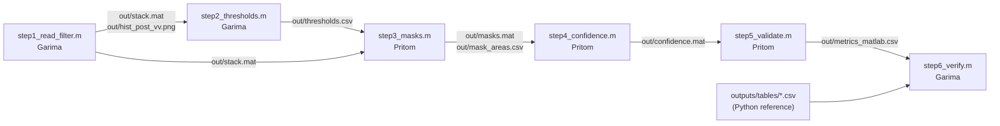

# MATLAB Layer — Build Guide & Work Split

**Goal:** re-implement the *image-processing core* of this project in MATLAB, in
course-native primitives (`graythresh`, `imfilter`, `imopen`, `bwareaopen`,
`strel`, `confusionmat`), and prove it reproduces the Python results.

**Why this is not busywork.** Two independent implementations reaching the same
thresholds and the same F1 is a *reproducibility proof*. In the viva it lets you say:
> "The result does not depend on the tool. NumPy/SciPy and MATLAB/IPT agree to
> ±0.05 dB on every threshold and ±0.001 on F1."

**Scope boundary — say this out loud in the presentation:**

> Python does the *data engineering* (STAC search, download, reprojection,
> mosaicking). MATLAB does the *image processing* (filtering, histogram,
> thresholding, morphology, confidence, validation).

MATLAB therefore **starts from `data/processed/*.tif`** — the files Python already
built. No downloading, no CRS work, no GeoTIFF writing in MATLAB (see §7, trap 6).

**Time budget:** 4 days (built 23 Nov, presentation 27 Nov). ~6 h each.

---

## 1. Ground rules

1. **Each person owns whole files. Never edit the other's file.** That is what makes
   parallel work conflict-free.
2. `.m` **text files only** — no `.mlx`. `.mlx` is a zipped binary, so git diffs are
   useless. (Same reasoning as the `.py` ↔ `.ipynb` rule.)
3. **MATLAB never modifies Python outputs.** It writes only into `matlab/out/`.
4. **Match the numbers, don't invent new ones.** If MATLAB disagrees with
   `outputs/tables/`, it is a bug to hunt — not a finding to report.
5. **Commit small, push often**, on the shared branch `matlab-layer`.

---

## 2. The numbers you must reproduce

These come from the Python run and are your acceptance tests.

### Thresholds (hard check, ±0.05 dB)

| Method | dB | Source |
|---|---|---|
| Otsu VV | **−12.5534** | `outputs/tables/mask_stats.csv` |
| Otsu VH | **−17.3090** | `outputs/tables/mask_stats.csv` |
| Change VV | **−3.0000** (fixed in `config.yaml`) | `mask_stats.csv` |
| Adaptive VV | **−9.5686** (median of the local threshold field) | `mask_stats.csv` |
| Kittler–Illingworth | **−14.0180** | `outputs/tables/candidate_members.csv` |
| GMM (2-component) | **−10.2654** | `candidate_members.csv` |

### Mask areas (soft check, ±0.5 %)

| Mask | km² |
|---|---|
| Otsu VV | 111.75 |
| Otsu VH | 143.02 |
| Change VV | 108.17 |
| Adaptive VV | 5.63 |
| Kittler | 97.78 |
| GMM | 145.87 |

> Areas from `candidate_members.csv` are ~0.3 % smaller than `mask_stats.csv` for the
> same mask — the two Python scripts use slightly different valid-pixel bases. Use
> `mask_stats.csv` for the four core masks and `candidate_members.csv` for
> Kittler/GMM, and don't chase a 0.3 % difference.

### Final ensemble (adopted: Otsu VV + Otsu VH + change + GMM, flood = k ≥ 2)

| Metric | Value |
|---|---|
| Precision | **0.8264** |
| Recall | **0.8016** |
| F1 | **0.8138** |
| IoU | 0.680 |

### Reliability by confidence class (GMM ensemble, monotonic)

| Class | k | Precision |
|---|---|---|
| Dry | 0–1 | 4.1 % |
| Low | 2 | 45.5 % |
| Medium | 3 | 83.7 % |
| **High** | 4 | **88.4 %** |

---

## 3. File contracts (this is what lets you work in parallel)

Each script reads **only** the files listed and writes **only** its own outputs.



| File | Owner | Reads | Writes |
|---|---|---|---|
| `setup_paths.m` | **Garima** | — | the struct `P` (all paths) |
| `step1_read_filter.m` | **Garima** | `data/processed/s1_*_db.tif` | `out/stack.mat`, `out/hist_post_vv.png`, `out/lee_before_after.png` |
| `step2_thresholds.m` | **Garima** | `out/stack.mat` | `out/thresholds.csv` |
| `step3_masks.m` | **Pritom** | `out/stack.mat`, `out/thresholds.csv` | `out/masks.mat`, `out/mask_areas.csv`, `out/masks_overview_matlab.png` |
| `step4_confidence.m` | **Pritom** | `out/masks.mat` | `out/confidence.mat`, `out/confidence_map.png` |
| `step5_validate.m` | **Pritom** | `out/confidence.mat`, `data/raw/sentinel2/s2_post_*.tif` | `out/metrics_matlab.csv`, `out/reliability_matlab.png`, `out/confusion_map.png` |
| `step6_verify.m` | **Garima** | `out/*.csv` + `outputs/tables/*.csv` | console PASS/FAIL table (screenshot it) |

**Naming note:** MATLAB script names must start with a **letter** — `01_read.m` is
invalid and can only be run via `run('01_read.m')`. Hence `step1_…`, `step2_…`.

**Unblock trick:** Pritom does not wait for Garima. Until `out/thresholds.csv`
exists, he hardcodes the six known values from §2 in his script, marked
`% TEMP — replace when thresholds.csv lands`, and switches to `readtable` on day 2.

---

## 4. Who does what

| | **Garima** (Track A: the image) | **Pritom** (Track B: the map & the score) |
|---|---|---|
| Files | `setup_paths.m`, `step1`, `step2`, `step6` | `step3`, `step4`, `step5` |
| Builds | read → nodata → Lee → dB → histogram → 6 thresholds | 6 masks → morphology → k-of-4 confidence → MNDWI → confusion → F1 |
| Concept to master | speckle is multiplicative in **linear** power; Otsu minimises intra-class variance | agreement ≠ accuracy; precision vs recall; what MNDWI measures |
| Viva lines | "why Lee", "why filter before dB", "why Otsu fails in urban", "why not deep learning" | "what is k-of-N", "what is kappa", "why H1 first failed", "is F1 0.81 good" |
| Hours | ~6 h | ~7 h |

**Shared account of the main finding** — both must be able to say it in 30 s:
> "With adaptive in the ensemble, High confidence was *less* accurate than Medium
> (77.1 % vs 88.6 %), so the hypothesis was rejected. Adaptive agreed with the
> others at kappa ≈ 0.06 — essentially random. Replacing it with GMM made the curve
> monotonic (88.4 > 83.7 > 45.6 %), and the High/Medium bootstrap intervals don't
> overlap. So agreement predicts reliability only when the members measure the same
> signal."

---

## 5. Schedule (23 → 27 Nov)

| Day | Garima | Pritom | Checkpoint |
|---|---|---|---|
| **Mon 23** | `setup_paths.m`, `step1` — read, nodata, Lee, dB, histogram | `step3` against hardcoded thresholds | Garima: histogram is bimodal; Pritom: mask areas within 0.5 % |
| **Tue 24** | `step2` — Otsu VV/VH, then Kittler, then GMM | `step4` — k-of-4, confidence classes, flood map | 6 thresholds within ±0.05 dB; class areas = 3.905 / 84.765 / 33.925 km² |
| **Wed 25** | `step6` — verification table | `step5` — MNDWI, `confusionmat`, reliability curve | **F1 = 0.8138 ± 0.001** |
| **Thu 26** | figures → slides; mock viva | figures → slides; mock viva | every §2 number ticked |
| **Fri 27** | present | present | |

**Hard cut-line, Wednesday night.** Anything not working then is dropped from the
demo and shown as a Python figure instead. A clean 4-method demo beats a broken
6-method one.

**Fallback if behind:** build only the *adopted* ensemble — Otsu VV, Otsu VH,
change, GMM. Drop adaptive and Kittler from MATLAB (their evidence already exists
in Python figures). That still reproduces F1 0.8138 and the monotonic curve.

---

## 6. Reading the data

```matlab
%% setup_paths.m  (Garima owns; everyone runs it first)
P.root      = 'D:\DIVP PROJECT';
P.processed = fullfile(P.root,'data','processed');
P.raw       = fullfile(P.root,'data','raw');
P.masks     = fullfile(P.root,'outputs','maps','masks');   % Python masks, read-only
P.tables    = fullfile(P.root,'outputs','tables');         % Python tables, read-only
P.out       = fullfile(P.root,'matlab','out');
if ~exist(P.out,'dir'), mkdir(P.out); end
```

```matlab
%% reading one layer
[I, R] = readgeoraster(fullfile(P.processed,'s1_post_vv_db.tif'),'OutputType','double');
I(I == -9999) = NaN;              % TRAP 1
valid = ~isnan(I);
```

Run a script without the GUI (saves memory, good for long jobs):

```powershell
matlab -batch "cd('D:\DIVP PROJECT\matlab'); setup_paths; step1_read_filter"
```

---

## 7. The traps (each one costs 30–60 min if you don't know it)

**Trap 1 — nodata before any statistic.** `−9999` must become `NaN` *first*, and
every threshold must be computed on `I(valid)` only. Python does
`threshold_otsu(post_vv[valid])`.

**Trap 2 — `graythresh` needs `[0,1]` input.**
```matlab
lo = min(x); hi = max(x);
t = lo + graythresh((x-lo)/(hi-lo))*(hi-lo);   % ~ -12.5534
```
Skip the rescale and you get a number in [0,1] and lose an hour.

**Trap 3 — filter boundary.** SciPy `uniform_filter` defaults to `mode='reflect'`,
which equals MATLAB **`'symmetric'`**, not `'replicate'`:
```matlab
mu = imfilter(L, ones(7)/49, 'symmetric');
```

**Trap 4 — connectivity.** SciPy `label` defaults to **4-connectivity**;
`bwareaopen` defaults to **8**. Pass it explicitly:
```matlab
m = bwareaopen(m, 100, 4);
```

**Trap 5 — Lee runs on linear power.** Undo dB first, filter, re-apply dB:
```matlab
L   = 10.^(I/10);
mu  = imfilter(L,      ones(7)/49, 'symmetric');
mu2 = imfilter(L.^2,   ones(7)/49, 'symmetric');
v   = max(mu2 - mu.^2, 0);
W   = v ./ (v + mu.^2/4);           % Cu = 1/L = 1/4 for 4 looks
Lf  = mu + W.*(L-mu);
Idb = 10*log10(Lf);
```

**Trap 6 — don't write GeoTIFFs from MATLAB.** Save `.mat` and `.png`. Writing
georeferenced rasters needs `refmat`/`geotiffwrite` fiddling and buys nothing for
the demo.

**Trap 7 — GMM is hand-rolled, and that's a feature.** Python fits 1-D
2-component EM on the **deterministic subsample `x(1:8:end)`** and then searches a
20 001-point grid for the point where the two Gaussians have equal density. Port it
literally — same stride, same 40 iterations, same grid — and you get −10.2654 dB.
Use `x(1:8:end)` (MATLAB is 1-based), not `x(::8)`.

**Trap 8 — memory.** 4032×3362 `double` ≈ 108 MB per layer. Keep at most ~6 live
at once (`clear` aggressively); you have 14 GB, so it's fine if you don't
accidentally make `double` copies of everything in a loop.

---

## 8. Definition of done (tick before the viva)

- [ ] `step1`: histogram shows two humps; Lee panel looks visibly smoother; `out/stack.mat` saved
- [ ] `step2`: all six thresholds within ±0.05 dB of §2
- [ ] `step3`: six mask areas within ±0.5 %; morphology removes the specks
- [ ] `step4`: class areas 3.905 / 84.765 / 33.925 km²; flood map = k ≥ 2
- [ ] `step5`: precision 0.8264, recall 0.8016, F1 0.8138; curve Dry < Low < Med < High
- [ ] `step6`: PASS/FAIL table prints all-green (screenshot for a slide)
- [ ] Both of you can explain the 30-second main finding without notes

---

## 9. Presentation split

| Slot | Speaker | Content |
|---|---|---|
| 1. Problem & data | Garima | flood mapping from SAR; why Sentinel-1; the June 2023 Brahmaputra event |
| 2. Preprocessing | Garima | Lee in linear power → dB; slope/water/urban masks; the demodulated histogram |
| 3. Methods | Garima | Otsu, change, adaptive, Kittler, GMM; **and why not deep learning** |
| 4. Confidence | Pritom | k-of-N; High/Med/Low/Dry; the flood map |
| 5. Validation | Pritom | MNDWI, confusion matrix, F1 0.8138 [0.801–0.826] |
| 6. The finding | Pritom → Garima | H1 rejected → GMM restores monotonicity → what it means |
| 7. MATLAB demo | both | Garima runs steps 1–2, Pritom runs 3–5, together run `step6` |

### The seven likely attacks — assign an owner

| # | Attack | Owner |
|---|---|---|
| 1 | "Why not a U-Net / deep learning?" | Garima |
| 2 | "Dry tarmac and sand also look dark in SAR." | Garima |
| 3 | "MNDWI > 0 is arbitrary; S2 is 2 days later." | Pritom |
| 4 | "Your 'post-flood' image is the peak, not the recession." | Pritom |
| 5 | "Isn't agreement circular, since you validate the same masks?" | Pritom |
| 6 | "Is F1 0.81 actually good?" | Garima |
| 7 | "You kept swapping members until the curve went monotonic — isn't that tuning?" | **both** |

Number 7 is the one that matters. Own it: *yes, the ensemble was revised after
seeing results, and we report the failed version (ADR-21) instead of hiding it;
the protection is leave-one-out (dropping any good method breaks the curve) plus
non-overlapping bootstrap intervals plus cross-terrain showing the thresholds don't
transfer — so the effect is mechanistic (kappa 0.8 vs 0.06), not a lucky combination.*

---

## 10. Git

```powershell
git checkout main
git checkout -b matlab-layer
git push -u origin matlab-layer
```

- Commit per working script: `matlab: step1 read+Lee+dB (threshold -12.55 reproduced)`.
- Because you own disjoint files, no merge conflicts are possible on this branch.
- When `step6` is all-green, open a PR into `main` and merge — the MATLAB layer then
  sits beside the Python pipeline as the reproducibility cross-check.
