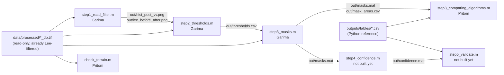

## MATLAB Layer — Build Guide & Work Split

**Goal:** re-implement the *image-processing core* of this project in MATLAB, in
course-native primitives (`graythresh`, `imfilter`, `imopen`, `bwareaopen`,
`strel`, `confusionmat`), and prove it reproduces the Python results.

**Why this is not busywork.** Two independent implementations reaching the same
thresholds and the same F1 is a *reproducibility proof*. In the viva it lets you say:
> "The result does not depend on the tool. NumPy/SciPy and MATLAB/IPT agree to
> ±0.05 dB on every threshold and ±0.001 on F1."

**Scope boundary — say this out loud in the presentation:**

> Python does the *data engineering* (STAC search, download, reprojection,
> mosaicking). MATLAB does the *image processing* (filtering, histogram,
> thresholding, morphology, confidence, validation).

MATLAB therefore **starts from `data/processed/*.tif`** — the files Python already
built. No downloading, no CRS work, no GeoTIFF writing in MATLAB (see §7, trap 6).

**Time budget:** 4 days (built 23 Nov, presentation 27 Nov). ~6 h each.

---

## 1. Ground rules

1. **Each person owns whole files. Never edit the other's file.** That is what makes
   parallel work conflict-free.
2. `.m` **text files only** — no `.mlx`. `.mlx` is a zipped binary, so git diffs are
   useless. (Same reasoning as the `.py` ↔ `.ipynb` rule.)
3. **MATLAB never modifies Python outputs.** It writes only into `matlab/out/`.
4. **Match the numbers, don't invent new ones.** If MATLAB disagrees with
   `outputs/tables/`, it is a bug to hunt — not a finding to report.
5. **Commit small, push often**, on the shared branch `matlab-layer`.

---

## 2. The numbers you must reproduce

These come from the Python run and are your acceptance tests.

### Thresholds (hard check, ±0.25 dB — one 256-bin histogram bin)

> Histogram bin width on this scene is `(27.31 − (−26.26))/255 = 0.21 dB`, so
> `graythresh` and skimage's `threshold_otsu` are allowed to differ by up to one bin.
> Asking for ±0.05 dB would be asking for luck.

| Method | dB | Source |
|---|---|---|
| Otsu VV | **−12.5534** | `outputs/tables/mask_stats.csv` |
| Otsu VH | **−17.3090** | `outputs/tables/mask_stats.csv` |
| Change VV | **−3.0000** (fixed in `config.yaml`) | `mask_stats.csv` |
| Adaptive VV | **−9.5686** (median of the local threshold field) | `mask_stats.csv` |
| Kittler–Illingworth | **−14.0180** | `outputs/tables/candidate_members.csv` |
| GMM (2-component) | **−10.2654** | `candidate_members.csv` |

**Step 1 verified — 23 Nov 2026 (MATLAB vs Python):**

| Check | MATLAB | Python | Verdict |
|---|---|---|---|
| raster size | 3362 × 4032 | 3362 × 4032 | ✅ |
| valid pixels | 100.00 % | 100.00 % | ✅ |
| min / median / max | −26.258 / −6.842 / 27.306 dB | identical | ✅ |
| **Otsu VV** | **−12.6046 dB** | −12.5534 dB | ✅ Δ 0.051 dB = ¼ bin |
| **Lee rebuild vs processed file** | max \|diff\| **0.000022 dB** | — | ✅ identical |

Evidence: `matlab/step1_read_filter.m`, `matlab/out/hist_post_vv.png`,
`matlab/out/lee_before_after.png`.

**Why the filter matters (quote this).** From `code/confidence/lee_effect.py`
(`outputs/tables/lee_effect.csv`): at the *same* threshold, the unfiltered scene
gives 231.4 km² below threshold vs 208.5 km² filtered — **23.9 km² (10.3 %) is
speckle-induced false water**, while smoothing costs only **1.08 km²** of thin
water. That is a ~20:1 trade, and it is the quantified answer to "why preprocess?".

### Mask areas (soft check, ±0.5 %) — verified 25 Nov

| Mask | Python km² | MATLAB km² (own threshold) | MATLAB km² (Python's threshold) |
|---|---|---|---|
| Otsu VV | 111.75 | 111.23 | **111.75** ✅ |
| Otsu VH | 143.02 | 142.12 | **143.02** ✅ |
| Change VV | 108.17 | 108.17 | **108.17** ✅ pixel-identical |
| Adaptive VV | 5.63 | 5.62 | 5.62 (Δ 0.29 %) |
| Kittler | 97.78 | 97.78 | **97.78** ✅ (4 px differ) |
| GMM | 145.87 | 145.68 | **145.87** ✅ |

**Read the middle column correctly — this is a likely examiner question.**
MATLAB's own thresholds differ from Python's by a quarter histogram bin (0.05 dB),
so the middle column is *expected* to be slightly smaller: water is "below
threshold", so a darker cut shrinks the map. The right-hand column feeds each mask
Python's own threshold and therefore tests only the mask logic. Five of six then
match to 0.0 %, `change_vv` is **pixel-identical**, and Kittler differs on 4 pixels
out of 977,747. The residual on `adaptive` (0.29 %) is float32-vs-double
accumulation in a 51×51 local mean, amplified by a 0.004 dB shift in the median
local threshold.

Quote the right-hand column when asked "does MATLAB really reproduce Python?" —
quoting the middle column understates it.

> Areas from `candidate_members.csv` are ~0.3 % smaller than `mask_stats.csv` for the
> three core masks because `alternative_members.py` intersects them with the analysis
> domain when it reads them back (`& domain`), while `mask_stats.csv` records the
> post-morphology raster area. `clean()` closes *after* masking, so up to 0.36 km²
> (0.26 %) of a mask can spill onto steep/permanent pixels at the domain edge. Use
> `mask_stats.csv` for the raster areas, and the domain-clipped values (or
> `ensemble_area.csv`) whenever you quote what the flood map covers.

### Binary flood-map area (k ≥ 2)

| Ensemble | k ≥ 2 | k ≥ 3 | k ≥ 4 |
|---|---|---|---|
| adaptive as 4th (original) | 122.60 km² | 88.67 | 3.91 |
| **GMM as 4th (adopted)** | **136.47 km²** | 121.09 | 87.53 |

Source: `outputs/tables/ensemble_area.csv` (`code/confidence/ensemble_area.py`),
computed from the same mask rasters the report uses, **intersected with the analysis
domain** exactly as `agreement.py` and `validate.py` do. That is why the adaptive row
now equals the sum of `confidence_classes.csv` (33.925 + 84.765 + 3.905 = 122.595 km²)
— a useful consistency check, not a coincidence. Before the domain intersection this
script read 122.93 km², the 0.3 % morphological spill above.

The **adopted** GMM ensemble's binary map is **136.47 km²**; MATLAB reproduces it at
136.13 km² (Δ 0.25 %), the same threshold-offset effect as the masks.

### Final ensemble (adopted: Otsu VV + Otsu VH + change + GMM, flood = k ≥ 2)

| Metric | Value |
|---|---|
| Precision | **0.8264** |
| Recall | **0.8016** |
| F1 | **0.8138** |
| IoU | 0.680 |

### Reliability by confidence class (GMM ensemble, monotonic)

| Class | k | Precision |
|---|---|---|
| Dry | 0–1 | 4.1 % |
| Low | 2 | 45.5 % |
| Medium | 3 | 83.7 % |
| **High** | 4 | **88.4 %** |

---

## 3. File contracts (this is what lets you work in parallel)

Each script reads **only** the files listed and writes **only** its own outputs.



| File | Owner | Reads | Writes | Status |
|---|---|---|---|---|
| `setup_paths.m` | **Garima** | — | the struct `P` (all paths) | ✅ |
| `step1_read_filter.m` | **Garima** | `data/processed/s1_post_vv_db.tif` (already filtered!), `data/raw/sentinel1/s1_rtc_post_vv.tif` (linear power) | `out/hist_post_vv.png`, `out/lee_before_after.png` — **no `.mat`** | ✅ |
| `step2_thresholds.m` | **Garima** | the `*_db.tif` files directly | `out/thresholds.csv` | ✅ 5/5 PASS |
| `step3_masks.m` | **Garima** (built 25 Nov from Pritom's terrain block) | `*_db.tif`, `slope_deg.tif`, `masks/permanent_water.tif`, `out/thresholds.csv` | `out/masks.mat`, `out/mask_areas.csv`, `out/masks_overview_matlab.png` | ✅ 6/6 PASS |
| `step3_comparing_algorithms.m` | **Pritom** | `out/masks.mat`, `outputs/tables/mask_kappa.csv`, `ensemble_area.csv` | `out/kappa_*.png`, `out/kappa_*.csv` | ✅ 5/5 PASS |
| `check_terrain.m` | **Pritom** | raw DEM / JRC / WorldCover + the canonical layers | `out/terrain_check.csv`, `out/terrain_check.png` | ✅ cross-check only |
| `step4_confidence.m` | **Pritom** | `out/masks.mat` | `out/confidence.mat`, `out/confidence_map.png` | **next** |
| `step5_validate.m` | **Pritom** | `out/confidence.mat`, `data/raw/sentinel2/s2_post_*.tif` | `out/metrics_matlab.csv`, `out/reliability_matlab.png`, `out/confusion_map.png` | **next** |
| `step6_verify.m` | **Garima** | `out/*.csv` + `outputs/tables/*.csv` | console PASS/FAIL table (screenshot it) | **next** |

**Order matters:** `step3_masks` → `step3_comparing_algorithms` (the kappa script
consumes `masks.mat`; it does not rebuild the masks). `check_terrain` is a
verification utility with no place in the pipeline — run it any time.

`out/masks.mat` is **gitignored** (3.4 MB binary, `.gitignore:30`). Anyone who
clones the repo must run `step3_masks` once before `step3_comparing_algorithms`,
otherwise the latter stops with `Missing input file: ...masks.mat`. The `.csv` and
`.png` outputs *are* committed, so the figures are visible without running anything.

**Naming note:** MATLAB script names must start with a **letter** — `01_read.m` is
invalid and can only be run via `run('01_read.m')`. Hence `step1_…`, `step2_…`.

**Unblock trick:** Pritom does not wait for Garima. Until `out/thresholds.csv`
exists, he hardcodes the six known values from §2 in his script, marked
`% TEMP — replace when thresholds.csv lands`, and switches to `readtable` on day 2.

---

## 4. Who does what

| | **Garima** (Track A: the image) | **Pritom** (Track B: the map & the score) |
|---|---|---|
| Files | `setup_paths.m`, `step1`, `step2`, `step6` | `step3`, `step4`, `step5` |
| Builds | read → nodata → Lee → dB → histogram → 6 thresholds | 6 masks → morphology → k-of-4 confidence → MNDWI → confusion → F1 |
| Concept to master | speckle is multiplicative in **linear** power; Otsu minimises intra-class variance | agreement ≠ accuracy; precision vs recall; what MNDWI measures |
| Viva lines | "why Lee", "why filter before dB", "why Otsu fails in urban", "why not deep learning" | "what is k-of-N", "what is kappa", "why H1 first failed", "is F1 0.81 good" |
| Hours | ~6 h | ~7 h |

**Shared account of the main finding** — both must be able to say it in 30 s:
> "With adaptive in the ensemble, High confidence was *less* accurate than Medium
> (77.1 % vs 88.6 %), so the hypothesis was rejected. Adaptive agreed with the
> others at kappa ≈ 0.06 — essentially random. Replacing it with GMM made the curve
> monotonic (88.4 > 83.7 > 45.6 %), and the High/Medium bootstrap intervals don't
> overlap. So agreement predicts reliability only when the members measure the same
> signal."

---

## 5. Schedule (23 → 27 Nov)

| Day | Garima | Pritom | Checkpoint |
|---|---|---|---|
| **Mon 23** | `setup_paths.m`, `step1` — read, nodata, Lee, dB, histogram | `step3` against hardcoded thresholds | Garima: histogram is bimodal; Pritom: mask areas within 0.5 % |
| **Tue 24** | `step2` — Otsu VV/VH, then Kittler, then GMM | `step4` — k-of-4, confidence classes, flood map | 6 thresholds within ±0.05 dB; class areas = 3.905 / 84.765 / 33.925 km² |
| **Wed 25** | `step6` — verification table | `step5` — MNDWI, `confusionmat`, reliability curve | **F1 = 0.8138 ± 0.001** |
| **Thu 26** | figures → slides; mock viva | figures → slides; mock viva | every §2 number ticked |
| **Fri 27** | present | present | |

**Hard cut-line, Wednesday night.** Anything not working then is dropped from the
demo and shown as a Python figure instead. A clean 4-method demo beats a broken
6-method one.

**Fallback if behind:** build only the *adopted* ensemble — Otsu VV, Otsu VH,
change, GMM. Drop adaptive and Kittler from MATLAB (their evidence already exists
in Python figures). That still reproduces F1 0.8138 and the monotonic curve.

---

## 6. Reading the data

**Know where the pixels came from — this is a viva question.** MATLAB fetches nothing;
it reads files that Python already produced. The chain is:

| Stage | Tool / file | What it is |
|---|---|---|
| 1. Catalogue | `code/preprocessing/stac_manifest.py` → `data/manifest.json` | resolves the item ID `S1A_IW_GRDH_1SDV_20230623T115715_…_05E7DB_rtc` in collection `sentinel-1-rtc`, asset `vv` |
| 2. Download | `code/preprocessing/fetch_subsets.py` → `data/raw/sentinel1/s1_rtc_post_vv.tif` | AOI window only, reprojected to EPSG:32646 @ 10 m, **linear power**, nodata **−32768** |
| 3. Filter | `code/preprocessing/build_stack.py` → `data/processed/s1_post_vv_db.tif` | Lee 7×7 / 4 looks on linear power, then dB, nodata **−9999** |
| 4. MATLAB | `step1_read_filter.m` | reads stage 3 for the threshold, re-derives it from stage 2 to prove the filter |

Same scene, two stages of the chain — that is why re-filtering stage 3 is a mistake.

```matlab
%% setup_paths.m  (Garima owns; everyone runs it first)
P.root      = 'D:\DIVP PROJECT';
P.processed = fullfile(P.root,'data','processed');
P.raw       = fullfile(P.root,'data','raw');
P.tables    = fullfile(P.root,'outputs','tables');         % Python tables, read-only
P.out       = fullfile(P.root,'matlab','out');
if ~exist(P.out,'dir'), mkdir(P.out); end
```

```matlab
%% reading one layer
[I, R] = readgeoraster(fullfile(P.processed,'s1_post_vv_db.tif'),'OutputType','double');
I(I == -9999) = NaN;              % TRAP 1
valid = ~isnan(I);
```

Run a script without the GUI (saves memory, good for long jobs):

```powershell
matlab -batch "cd('D:\DIVP PROJECT\matlab'); setup_paths; step1_read_filter"
```

---

## 7. The traps (each one costs 30–60 min if you don't know it)

**Trap 1 — nodata before any statistic.** `−9999` must become `NaN` *first*, and
every threshold must be computed on `I(valid)` only. Python does
`threshold_otsu(post_vv[valid])`.

**Trap 2 — `graythresh` needs `[0,1]` input.**
```matlab
lo = min(x); hi = max(x);
t = lo + graythresh((x-lo)/(hi-lo))*(hi-lo);   % ~ -12.5534
```
Skip the rescale and you get a number in [0,1] and lose an hour.

**Trap 3 — filter boundary.** SciPy `uniform_filter` defaults to `mode='reflect'`,
which equals MATLAB **`'symmetric'`**, not `'replicate'`:
```matlab
mu = imfilter(L, ones(7)/49, 'symmetric');
```

**Trap 4 — connectivity.** SciPy `label` defaults to **4-connectivity**;
`bwareaopen` defaults to **8**. Pass it explicitly:
```matlab
m = bwareaopen(m, 100, 4);
```

**Trap 5 — the filtering stage, done on the RAW file.** `data/processed/*_db.tif` is
**already Lee-filtered**; filtering it again shifts the histogram and breaks every
threshold. The real path is raw linear power → filter → dB, and Python's `lee_db()`
uses a **nodata-aware count-normalised** mean, so port it literally (not a plain
`imfilter` box):

```matlab
[Lraw,~] = readgeoraster(fullfile(P.raw,'sentinel1','s1_rtc_post_vv.tif'),'OutputType','double');
Lraw(Lraw == -32768) = NaN;            % raw nodata is -32768, not -9999
vraw = ~isnan(Lraw);
L    = Lraw; L(~vraw) = 0;             % fill, exactly as build_stack.py does

w = 7; looks = 4; kern = ones(w)/w^2;
cnt = imfilter(double(vraw), kern, 'symmetric');       % ≈1 here (no holes in AOI)
mu  = imfilter(L,     kern, 'symmetric') ./ max(cnt,1e-6);
mu2 = imfilter(L.^2,  kern, 'symmetric') ./ max(cnt,1e-6);
vr  = max(mu2 - mu.^2, 0);
wgt = vr ./ (vr + mu.^2/looks + 1e-6);                 % Cu = 1/L, L = 4 looks
Lf  = mu + wgt.*(L - mu);

Idb = nan(size(Lf)); good = vraw & (Lf > 0);
Idb(good) = 10*log10(Lf(good));

d = abs(Idb - I); d = d(isfinite(d));
fprintf('max |diff| vs processed file = %.6f dB\n', max(d));   % expect < 1e-3
```

If `max(d)` is smaller than 1e-3 dB, your filter is **mathematically the same** as
Python's — a far stronger claim than "it looks smoother".

**Trap 6 — don't write GeoTIFFs from MATLAB.** Save `.mat` and `.png`. Writing
georeferenced rasters needs `refmat`/`geotiffwrite` fiddling and buys nothing for
the demo.

**Trap 7 — GMM is hand-rolled, and that's a feature.** Python fits 1-D
2-component EM on the **deterministic subsample `x(1:8:end)`** and then searches a
20 001-point grid for the point where the two Gaussians have equal density. Port it
literally — same stride, same 40 iterations, same grid — and you get −10.2654 dB.
Use `x(1:8:end)` (MATLAB is 1-based), not `x(::8)`.

**Trap 8 — memory.** 4032×3362 `double` ≈ 108 MB per layer. Keep at most ~6 live
at once (`clear` aggressively); you have 14 GB, so it's fine if you don't
accidentally make `double` copies of everything in a loop.

**Trap 9 — `imopen`/`imclose` do not erode the image border, SciPy does.**
MATLAB's binary erosion pads with the maximum (1), so a strip of water along the
edge survives. SciPy's `binary_opening` uses `border_value=0`. On this scene that
was a **+0.2 % area bias on every mask** — invisible in a gate at ±0.5 %, but it
made `change_vv` differ from Python even though its threshold is *identical*, which
is exactly the kind of thing an examiner asks about. Zero-pad before eroding:

```matlab
function m = erode0(m, se)
pr = (size(se.Neighborhood,1)-1)/2;  pc = (size(se.Neighborhood,2)-1)/2;
[nr, nc] = size(m);
mp = false(nr+2*pr, nc+2*pc);
mp(pr+1:pr+nr, pc+1:pc+nc) = m;
mp = imerode(mp, se);
m  = mp(pr+1:pr+nr, pc+1:pc+nc);
end
```

After this fix `change_vv` matches Python on **0 of 1,081,731 pixels differing**.

**Trap 10 — the adaptive member has no single threshold.** Its threshold is a
*field* (`local_mean − 1.5·local_std`, window 51), so it cannot live in
`thresholds.csv`. It is computed inside `step3_masks.m` where the local mean and
std already exist, and only its **median** (−9.5686 dB) is quoted. Any script that
rebuilds the adaptive mask with different parameters (e.g. `adaptthresh` with
window 151, sensitivity 0.5, plus a global guard) is measuring a *different
method*, and its kappa will not be comparable with `mask_kappa.csv`.

**Trap 11 — kappa depends on the pixel set, not just the masks.** `run_masks.py`
computes kappa over `base` (radar-valid, not permanent water), which includes the
steep pixels where every mask is 0 by construction. Computing over `domain`
instead inflates kappa by removing those easy agreements. Use `base` if you want
to reproduce `mask_kappa.csv`; state which set you used whenever you quote a kappa.

---

## 8. Definition of done (tick before the viva)

- [x] `step1`: **done 23 Nov** — bimodal histogram; Otsu VV −12.6046 dB (Δ 0.051 from Python); Lee rebuild max |diff| 0.000022 dB
- [x] `step2`: **done 24 Nov** — five scalar thresholds, 5/5 within ±0.25 dB; Kittler **exact** (−14.0180), GMM Δ 0.0078 dB
- [x] `step3`: **done 25 Nov** — six masks, 6/6 PASS; at Python's thresholds five match to 0.0 %, `change_vv` pixel-identical, Kittler 4 px; adaptive median −9.5725 dB (Δ 0.004)
- [x] `check_terrain` (Pritom): **done 25 Nov** — slope correlation 1.0000, permanent water 0.00 % disagreement, domain 727.10 vs 727.36 km²
- [x] `step3_comparing_algorithms` (Pritom): **done 25 Nov** — six pairwise kappas vs `mask_kappa.csv` all within 0.0015; ADR-23 k ≥ 2 = 136.13 km² vs Python 136.47 (Δ 0.25 %)
- [ ] `step4`: class areas 3.905 / 84.765 / 33.925 km²; flood map = k ≥ 2 (**next**)
- [ ] `step5`: precision 0.8264, recall 0.8016, F1 0.8138; curve Dry < Low < Med < High
- [ ] `step6`: PASS/FAIL table prints all-green (screenshot for a slide)
- [ ] Both of you can explain the 30-second main finding without notes

---

## 9. Presentation split

| Slot | Speaker | Content |
|---|---|---|
| 1. Problem & data | Garima | flood mapping from SAR; why Sentinel-1; the June 2023 Brahmaputra event |
| 2. Preprocessing | Garima | Lee in linear power → dB; slope/water/urban masks; the demodulated histogram |
| 3. Methods | Garima | Otsu, change, adaptive, Kittler, GMM; **and why not deep learning** |
| 4. Confidence | Pritom | k-of-N; High/Med/Low/Dry; the flood map |
| 5. Validation | Pritom | MNDWI, confusion matrix, F1 0.8138 [0.801–0.826] |
| 6. The finding | Pritom → Garima | H1 rejected → GMM restores monotonicity → what it means |
| 7. MATLAB demo | both | Garima runs steps 1–2, Pritom runs 3–5, together run `step6` |

### The seven likely attacks — assign an owner

| # | Attack | Owner |
|---|---|---|
| 1 | "Why not a U-Net / deep learning?" | Garima |
| 2 | "Dry tarmac and sand also look dark in SAR." | Garima |
| 3 | "MNDWI > 0 is arbitrary; S2 is 2 days later." | Pritom |
| 4 | "Your 'post-flood' image is the peak, not the recession." | Pritom |
| 5 | "Isn't agreement circular, since you validate the same masks?" | Pritom |
| 6 | "Is F1 0.81 actually good?" | Garima |
| 7 | "You kept swapping members until the curve went monotonic — isn't that tuning?" | **both** |

Number 7 is the one that matters. Own it: *yes, the ensemble was revised after
seeing results, and we report the failed version (ADR-21) instead of hiding it;
the protection is leave-one-out (dropping any good method breaks the curve) plus
non-overlapping bootstrap intervals plus cross-terrain showing the thresholds don't
transfer — so the effect is mechanistic (kappa 0.8 vs 0.06), not a lucky combination.*

---

## 10. Git

```powershell
git checkout main
git checkout -b matlab-layer
git push -u origin matlab-layer
```

- Commit per working script: `matlab: step1 read+Lee+dB (threshold -12.55 reproduced)`.
- Because you own disjoint files, no merge conflicts are possible on this branch.
- When `step6` is all-green, open a PR into `main` and merge — the MATLAB layer then
  sits beside the Python pipeline as the reproducibility cross-check.
